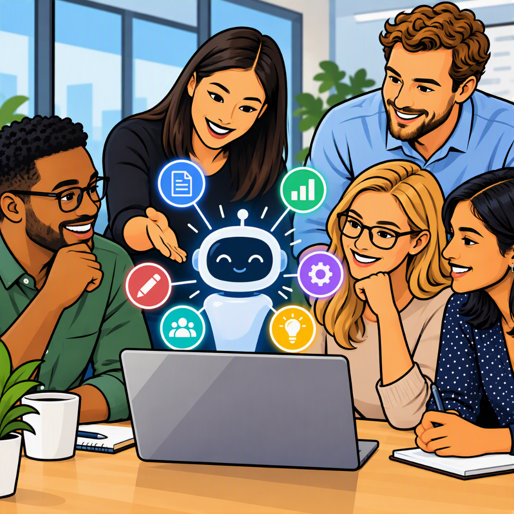

AI is here. But are we really using it?

According to [McKinsey](https://www.mckinsey.com/capabilities/quantumblack/our-insights/the-state-of-ai-2025) about 88 % of organizations are using it. Yet there is an interesting gap behind that number: nearly two-thirds say their organizations have not yet begun scaling AI across the enterprise. This was in 2025, but what changed?

Meanwhile almost all organizations do use AI. But the scaling just increased by 13 % compared to last year as McKinsey puts it in their [2026 study](https://www.mckinsey.com/capabilities/quantumblack/our-insights/the-state-of-ai).

In other words, **AI adoption is widespread. AI maturity is not.**

And I see the same thing when talking to people across different organizations. Many already use tools such as ChatGPT, Claude or Microsoft Copilot, but often primarily as a more powerful alternative to Google Search: ask a question, get an answer, maybe summarize a document or draft an email.

There is nothing wrong with that. It is useful. But it barely scratches the surface of what is possible.

|  |
|:--:|
| *Image by the author created in cooperation with MS Copilot* |

If you are deeply interested in AI yourself, it is easy to fall into a bubble. I have been working with machine learning and AI since 2016, and generative AI has become part of my daily work over the past few years. Because I am surrounded by the topic, it would be easy for me to assume that everyone else is using these technologies in the same way (greetings from confirmation bias).

But, people are not broadly using AI on a deeper level.

And perhaps that is one of the biggest challenges of AI adoption today. Giving people access to AI is not the same as enabling them to actually use it.

The real shift happens when we start integrating AI into the way we actually work: combining it with [automated flows](https://matthiaskarner.com/2026/07/Here-is-How-I-Use-Power-Automate-Across-My-Role/), connecting it to [our information and processes](https://matthiaskarner.com/2026/10/Part-3-Building-a-Decision-Centric-Productivity-System/), or introducing agents that can take on parts of a workflow on their own or even become members of your (virtual) team.

It is not about turning everyone into an AI expert. It is about showing people what is possible and giving them enough understanding to become curious to identify the opportunities hidden in their own daily work.

That is what I want to explore in this article.

...

## Access

Give people safe and easy access to capable AI tools. This is what many organizations already do. Bigger comapnies usually govern what AI can be used by employees. For my current organization, for example, it is Microsoft Copilot. Other AI tools are shut out from use to keep sure that no confidential information wanders off by a not so careful employee.

And yes that can become a problem. There are dozens examples on when an employee used critical information within a chat and information got publicly available.

So yes governance is a good thing. However, it is a fine line between keeping confidential information within an organization and limiting the true potential.

In my opinion it is important that there is governance and simultaneously clear information on (i) why that governance exists, but also on (ii) what is possible within the governance (beyond a simple use of chat).

## Understanding

Show what AI can and cannot do.

For people who are not interested in AI privately, it can be hard to grasp the capabilities of AI. Therefore, it is a good practice to show them the capabilities of AI in a context they already understand. In my experience this works well. Show them how they can integrate AI in the existing workflows and how they can safe time.

After a "click-moment" many privious non-AI users overshoot and try to apply AI on everything. Therefore, it is also important to provide them also with information on what AI cannot (yet) do and what you shouldn't do with AI. I think you don't have to send very employee of an organization to a multi-day seminar on AI, but a basic AI literacy is important to bring AI to the people in an organization.

## Experimentation

Let people discover use cases in their own work.

This is where I think you need AI power users in larger organizations. People who are genuinly interested in the AI topic and are willing to (i) dive deeper into the topic and (ii) also serve as knowledge-transfering agent within the departments.

They should get more AI tools / capabilities than the average user and should be encouraged to experiment.

This has to effects:
- learning and improving AI literacy
- creating solutions for the departments that show the average user what is possible with the technology and therefore gain more (and broader) interest in the topic.

## Integration and Transformation

Move from prompts to flows, agents, data and actual processes.

This can actually be the (automatic) result of the experimation phase. If AI power users have access to the apropriate tools, they will move organically towards a deeper integration of AI - at least in my experience.

What are saved prompts at the beginning become simple agents with a predefined ruleset and turn to more capable agents with their knowledge-bases, connections and own workflows.

This is also when the transformation happens. Usage of AI moves from simply making existing tasks 10% faster to redesigning work completely

## What we did to to bring AI to the people

In my organization we decided to define AI power users and train them on how to use AI and especially how to use the AI tools available (within our limited corporate AI stack).

For every department 1-2 people were nominated to join the AI peer program.

For now we hosted one event with them already and it was quite a success. They were interested not just in the AI tools themselves, but also in surrounding tools like workflow-automation tools that can be integrated with AI.

## Access

Give people safe and easy access to capable AI tools.

Most organizations get this far. Companies usually govern which AI tools their employees may use. In my organization that is Microsoft Copilot. Other tools are blocked so that confidential information doesn’t leave the company through a careless prompt.

That concern is legitimate. In 2023, [Samsung engineers pasted confidential source code and meeting notes into ChatGPT](https://www.techradar.com/news/samsung-workers-leaked-company-secrets-by-using-chatgpt), where the company could no longer retrieve it.

So governance is a good thing. But there is a fine line between protecting confidential information and limiting the true potential. What helps is being explicit about two things: why the governance exists, and what is possible within it, far beyond simple chat.

## Understanding

Show what AI can and cannot do.

If you are not interested in AI privately, it is hard to grasp what it can do. In my experience, the best way is to show it in a context people already know: their own workflows, and how AI saves them time there.

After the “click moment”, many former non-users overshoot and want to apply AI to everything. So it is just as important to explain what AI cannot (yet) do and what you should not use it for. You don’t need to send every employee to a multi-day seminar, but basic AI literacy is a prerequisite for bringing AI to the people.

## Experimentation

Let people discover use cases in their own work.

This is where larger organizations need AI power users: people who are genuinely interested, willing to go deeper, and able to act as knowledge multipliers in their departments. They should get more tools and capabilities than the average user, and explicit encouragement to experiment.

This has two effects:

They build skills and improve their own AI literacy.
They create solutions for their departments that show everyone else what is possible, which builds broader interest.

## Integration and Transformation

Move from prompts to flows, agents, data and processes.

This is often the natural result of the experimentation phase. Power users with the right tools move toward deeper integration on their own, at least in my experience.

Saved prompts become simple agents with a predefined ruleset. These turn into more capable agents with knowledge bases, connections and their own workflows.

That is also where the transformation happens. AI stops making existing tasks 10 % faster and starts changing how the work is designed.

## What we are doing to bring AI to the people

In my organization we defined AI power users and are training them, especially on the tools available within our limited corporate AI stack. Each department nominated one or two people for our AI peer program.

The first workshop was about understanding. We presented our AI governance, showed a few use cases and motivated the participants to try more on their own. It worked. They were interested not only in the AI tools themselves, but also in surrounding tools such as workflow automation that can be combined with AI.

We then prepared a second workshop, with a hands-on approach. With external support and moderation, we worked on real AI use cases together. Now after that, the participants are on their own: they develop use cases in their departments, and we set an incentive for it.

<!-- 
- Woran habt ihr konkret gearbeitet, und was ist dabei entstanden?
- Was hat euch überrascht, zum Beispiel Fragen, Hürden oder Tools, die besser oder schlechter ankamen als gedacht?
- Wie viele Teilnehmer haben schon angefangen, eigene Use Cases anzugehen?
-->

## Conclusion

Adoption is easy to measure. Maturity is not. Access to a tool doesn’t make anyone use it well, and neither does a single training.

What works, at least in my experience, is a sequence: safe access, understanding in the context of people’s own work, room to experiment, and then deeper integration, mostly driven by the people who experiment.

I don’t know yet how far our peer program will take us. But AI reaches people when they build something useful in their own work, not when they are told it exists.