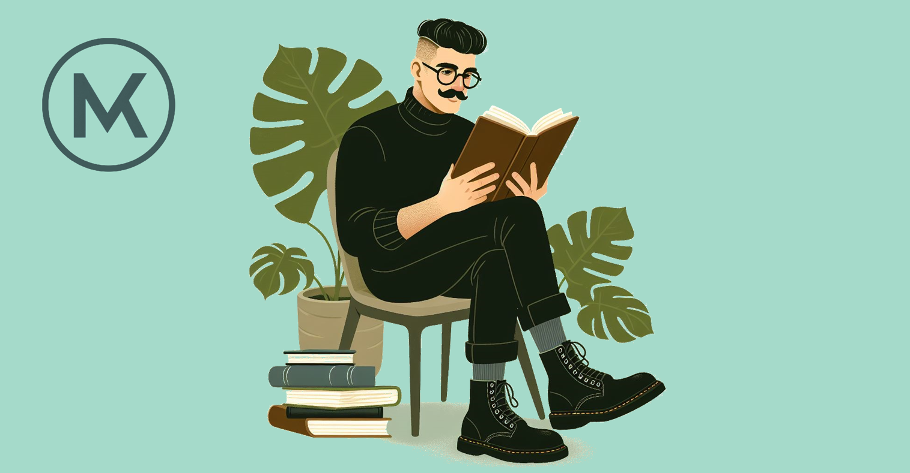

inkl. Algorithms to live by -> Bogen zum nächsten Artikel

The year is almost over and I am already thinking  about what to read next. As every year, I amjoining the Goodreads challenge. In 2026 I read 12 / 12 books and achieved my goal. For 2027 I set my goal to 12 again - so one book per month it is.

As in [2026](), I've put together a list of must-reads to start with. I don't plan the whole year, because something new and interesting always pops up. But these seven are the ones I want to read for sure.

I picked them with two things in my mind. They should be useful for me and they should be useful for people in a similar spot: leading teams, working with technology, trying to make better decision. So the list mices recent books and a few classics.

|  |
|:--:|
| *Image created in cooperation with DALL·E 3* |

One book isn't on the list below, because I am already reading it: [Algorithms to Live By](https://www.google.com/search?q=algorithms+to+live+by) (Brian Christian & Tom Griffiths, 2016). It applies computer science ideas like optimal stopping, explore vs. exploit and scheduling to everyday decisions. I expect to finish it around New Years Eve. It's also the reason *Decisive* is on the list.

Non-fiction
1. [Leadership Intelligence](https://www.google.com/search?q=Leadership+Intelligence+Caroline+Webb) (Caroline Webb, 2026): I want a leadership book as my first read of the year and I chose this one. Webb is an economist, a former Mc Kinsey partner and the author of *How to Have a Good Day*. The book covers 21 everyday management challenges and uses behavioral science to give practical advice. It also looks at how leaders can work with human and artificial intelligence in the same team. It came out in fall 2026, so it's rather new and I can'T tell you whether it holds up. But I'll let you know.
2. [Decisive](https://www.google.com/search?q=Decisive+Chip+%26+Dan+Heath) (Chip & Dan Heath, 2013): Decisions are at the cenbter of how I work and how I think about my own system. *Decisive* is a classic on how to avoid the usual traps: too few option, confirmation bias and emotions in the short-term. It's the psychology side of decision-making and I am reading it close after *Algorithms to Live By* covering the algorithmic side.
3. [The Nvidia Way](https://www.google.com/search?q=The+Nvidia+Way) (Tae Kimm, 2024): I found the Jensen Huang always a fascinating charakter. Brought up with no wealth, self-made billionaire and behind one of the most crucial businesses at the center of the AI boom: Nvidia. I am looking forward to learn how the comapny got there and what its culture and leadership look like from the inside.
4. [Rewired](https://www.google.com/search?q=Rewired+McKinsey) (McKinsey, 2026): A playbook for digital and AI transformation. I work on this in industrial manufacturing, so I am curious how much of it survives contact with real constraints.
5. [Code](https://www.google.com/search?q=Code+The+Hidden+Language+of+Computer+Hardware+and+Software) (Charles Petzold, 2000): This was a recommendation from a collague of mine (I recommended *Algorithms to Live By* to him as "exchange"). It explains how computers work, starting from simple signals and building up to hardware and software. It's rather old, but the basics haven't changed. As my collague told me, it also has an interesting section on cryptographie and how it was used already back in ancient history.
6. [The Gene: An Intimate History](https://www.google.com/search?q=The+Gene+An+Intimate+History) (Siddhartha Mukherjee, 2016): This is something outside my usual topics (like Everyhing Is Tuberculosis in 2027) - I do think it is refreshing to mix in a book outside my main topics. As the title suggests, it tells the history of genetics and what it means for us today.
7. [Die Macht der Geographie](https://www.google.com/search?q=Prisoners+of+Geography) (Tim Marshall, 2015): Ten maps to explain world politics (English title: Prisoners of Geography). Supply chains, energy and trade routes are shaped by geography. I really like the basic idea of the book that politics is actually intensively shaped by geography which also has massive influence on our today economy. I am already curious.

Deyond these seven, here are bokks I am also considering for 2027:

- [Same as Ever](https://www.google.com/search?q=Same+as+Ever+Morgan+Housel) (Morgan Housel, 2013): A book about what never changes. I liked Housel's earlier books, so this is a strong candidate.
- [Profits, Prophets, Coaches, and Kings](https://www.google.com/search?q=Profits%2C+Prophets%2C+Coaches%2C+and+Kings) (Jared Diamond, 2026): A quite new book on leadership that already has mixed reviews. However, I'd like to judge it myself.
- Unhinged Habits (Jonathan Goodman, 2026)
- The Let Them Theory (Mel Robbins, 2024)
- The Upside of Stress (Kelly McGonigal, 2015)

Novel Considerations:
- Animal Farm (George Orwell, 1945): I didn't fit this one in 2026, so I might read it next year.

What's on your list for 2027? Let me know. I am always looking for good recommendations.

Thank you for reading and have a great 2027 full of good books!